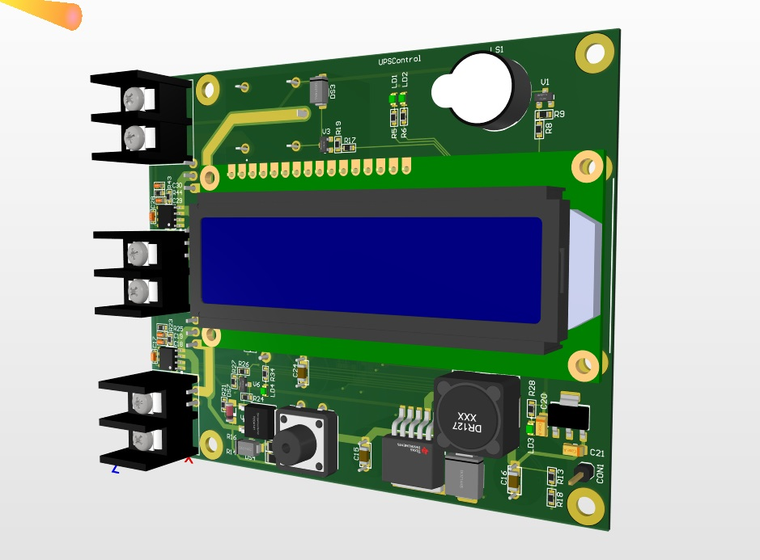
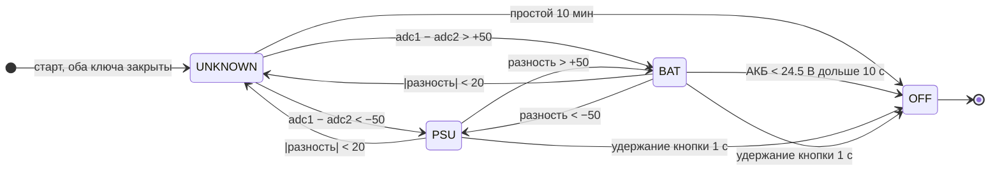
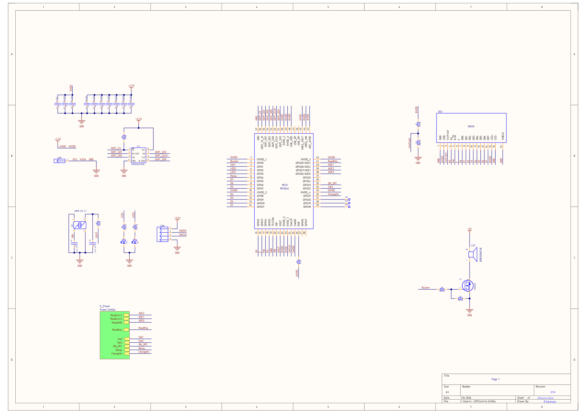
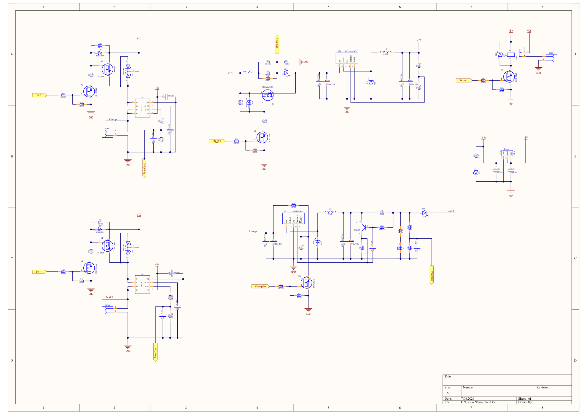

<div align="center">

# UPSPrinter

**Бесперебойник для 3D-принтера на RP2040**

Выбирает источник питания по току, шунтирует диоды MOSFET-ключами, следит за АКБ и заряжает её по необходимости.




</div>

---

## Что делает устройство

Плата стоит между блоком питания и принтером и подхватывает нагрузку от аккумулятора, если сеть пропала. Прошивка решает пять задач:

| Задача | Как решается |
|---|---|
| **Выбор источника** | Два датчика тока на эффекте Холла (ACS712) стоят в ветках блока питания и АКБ. По **разности** их показаний прошивка понимает, кто сейчас реально питает нагрузку, и открывает MOSFET, шунтирующий диод этой ветки. Абсолютные значения АЦП не важны, калибровка под конкретный датчик не нужна. |
| **Индикация** | Дисплей 16×2 показывает источник (`220V` / `BAT` / `ON`), напряжение АКБ и признак зарядки `CHG`. Два светодиода дублируют источник. |
| **Контроль АКБ** | Напряжение АКБ измеряется через делитель 100 кОм / 11 кОм. При низком заряде срабатывает предупреждение, при глубоком разряде плата отключается сама. |
| **Зарядка** | Зарядник на LM2596 включается и выключается по напряжению АКБ с гистерезисом. Решение принимается раз в 30 секунд, поэтому шум АЦП не дёргает зарядку. |
| **Сервис** | Бузер, реле нагрузки (включается после старта), кнопка питания с фиксацией, автоотключение при простое, аппаратный watchdog. |

### Логика выбора источника

После включения оба ключа **закрыты**. Так АКБ не подаёт напряжение в отсутствующий блок питания. Ключ открывается, только когда через диод реально потёк ток.



Между порогами `20` и `50` состояние не меняется. Это гистерезис против дребезга ключей.

### Что происходит с АКБ

| Событие | Порог | Реакция |
|---|---|---|
| Включить зарядку | АКБ < 26.8 В | `CHG` на экране, запускается LM2596-зарядник |
| Выключить зарядку | АКБ > 28.2 В | зарядка отключается |
| Зарядка при работе от АКБ | всегда | запрещена: пин гасится мгновенно, периодическая проверка её не включит |
| Низкий заряд | АКБ < 24.8 В | надпись `LOW BATTERY`, прерывистый писк бузера |
| Выход из низкого заряда | АКБ > 25.2 В | источник снова определяется по токам |
| Аварийное отключение | АКБ < 24.5 В в течение 10 с | `SYSTEM OFF`, сброс защёлки питания |
| Простой принтера | оба ключа закрыты 10 мин | `IDLE SHUTDOWN` и отключение |
| Кнопка | удержание 1 с | `SYSTEM OFF` и отключение |

Таймер простоя работает так: принтер закончил печать, перестал потреблять большой ток, ни один ключ не открывается. Через заданное время плата считает, что принтер можно отключать.

---

## Схема

Схема нарисована в Altium. Полный комплект (3D-вид, топология, схемы, BOM) лежит в [`suport/UPSControl.PDF`](suport/UPSControl.PDF).

### Управляющая часть

RP2040 в «голом» виде (не плата Pico): флеш W25Q16, кварц 12 МГц, дисплей 1602A, бузер через MOSFET, выход SWD для прошивки.



### Силовая часть

Две ветки датчика тока и ключа (блок питания и АКБ), защёлка питания на кнопке, понижающий преобразователь 5 В, зарядник АКБ и выход на реле.



### Назначение выводов

| GPIO | Сигнал | Назначение |
|---|---|---|
| 0 | `Buzzer` | бузер |
| 1 | `SW1` (`PIN_BAT_TR`) | ключ ветки АКБ |
| 22 | `SW2` (`PIN_PSU_TR`) | ключ ветки блока питания |
| 2 / 3 | `LED2` / `LED1` | светодиоды «блок питания» / «АКБ» |
| 4 | `Relay` | реле нагрузки |
| 21 | `ChargeOn` | включение зарядника |
| 23 | `ON_OFF` | защёлка питания |
| 29 | `ReadKey` | кнопка |
| 26 / ADC0 | `ReadAKB` | напряжение АКБ |
| 27 / ADC1 | `ReadCurr1` | ток ветки АКБ |
| 28 / ADC2 | `ReadCurr2` | ток ветки блока питания |
| 15 / 14 / 13 | `RS` / `RW` / `E` | дисплей |
| 12…5 | `D0`…`D7` | шина данных дисплея (8 бит) |

---

## Устройство прошивки

```
UPSPrinter/
├── main.c            # точка входа: doWork() и бесконечный цикл Work()
├── work.c / work.h   # вся логика, пороги и распиновка
├── lcd1602.c / .h    # драйвер HD44780 в 8-битном режиме
├── CMakeLists.txt
└── suport/           # фото платы, схема, BOM
```

Прошивка построена на простом кооперативном планировщике: каждая задача описывается структурой `task_t` (функция и период), а главный цикл по очереди вызывает `taskRun()`.

| Задача | Период | Что делает |
|---|---|---|
| `funcButtonMonitor` | 50 мс | кнопка, удержание 1 с = выключение |
| `funcADCMonitor` | 100 мс | чтение 3 каналов АЦП, фильтр, пересчёт в вольты |
| `funcLogicTask` | 100 мс | выбор источника, ключи, светодиоды, контроль АКБ, таймер простоя |
| `lcdPrintTaskFunc` | 100 мс | вывод на дисплей |
| `buzzerTaskFunc` | 100 мс | шаблоны писка |
| `shedulerBuzzerTaskFunc` | 100 мс | выбор шаблона бузера |
| `funcChargeTask` | 30 с | решение «заряжать или нет» |

Аппаратный watchdog (таймаут 1.5 с) перезагружает контроллер, если главный цикл завис. Во время штатного выключения он продолжает обновляться, иначе перезагрузка отменила бы отключение.

---

## Настройка

Все параметры собраны в начале [`work.h`](work.h):

| Параметр | По умолчанию | Смысл |
|---|---|---|
| `SOURCE_SWITCH_THRESHOLD` | 50 | разность АЦП датчиков, при которой открывается ключ источника |
| `SOURCE_NEUTRAL_THRESHOLD` | 20 | разность, ниже которой оба ключа закрываются |
| `IDLE_SHUTDOWN_MIN` | 10 | минут простоя до автоотключения |
| `CHARGE_CHECK_INTERVAL_MS` | 30000 | как часто решается вопрос о зарядке |
| `CHARGE_V_ON` / `CHARGE_V_OFF` | 27.0 / 28.0 В | пороги включения и выключения зарядки |
| `LOW_BATTERY` | 25.0 В | порог предупреждения о низком заряде |
| `OFF_BATTERY` | 24.5 В | порог аварийного отключения |
| `VOLTAGE_HYSTERESIS` | 0.2 В | гистерезис для всех сравнений напряжения |
| `HOLD_TIME_MS` | 1000 | время удержания кнопки для выключения |
| `WATCHDOG_TIMEOUT_MS` | 1500 | таймаут watchdog |

Пороги `SOURCE_*` заданы в единицах АЦП и относятся к **разности** показаний двух датчиков. Общее смещение нуля датчиков Холла в разности сокращается.

---

## Сборка и прошивка

Нужны [Pico SDK](https://github.com/raspberrypi/pico-sdk) 2.3.0, CMake, Ninja и ARM GCC. Проще всего поставить расширение **Raspberry Pi Pico** для VS Code: оно скачает всё само, а проект уже содержит конфигурацию в `.vscode/`.

```bash
cmake -S . -B build -G Ninja
cmake --build build
```

На выходе `build/UPSPrinter.elf` и `build/UPSPrinter.uf2`.

Плата прошивается по SWD через разъём `CON2` (3.3 V, SWDIO, SWCLK, GND) с помощью CMSIS-DAP-отладчика. В VS Code для этого есть задача **Flash**, а отладка запускается конфигурацией **Pico Debug**.

---

## Безопасность

Плата работает с сетевым блоком питания и аккумулятором. Перед включением проверьте полярность подключения и допустимый ток ключей. Пороги напряжения в `work.h` рассчитаны на конкретную АКБ, при другой сборке подберите их под её характеристики.
